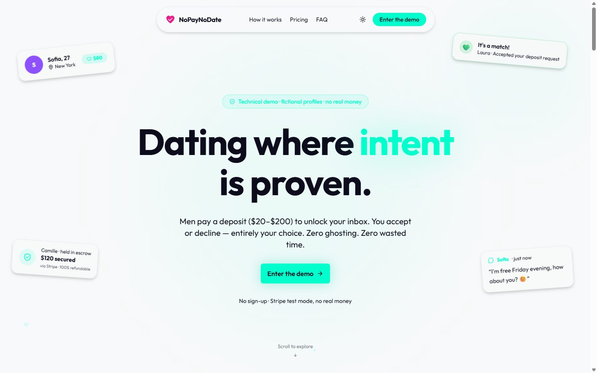

# NoPayNoDate

Démonstration technique d'une application de rencontre où l'homme verse un dépôt, fixé par la femme, pour lui envoyer une demande de rendez-vous. Le dépôt est bloqué jusqu'à sa décision : remboursé si elle refuse, versé (moins 10 % de commission) quand les deux confirment que le rendez-vous a eu lieu.

**Ce site n'est pas un vrai service.** Les profils sont fictifs, les paiements passent par Stripe en mode test et aucun argent réel ne circule. Projet de portfolio de [TeeBo Studio](https://teebostudio.fr).

Démo en ligne : https://nopaynodate.teebostudio.fr



## Essayer la démo

1. Cliquer sur « Enter the demo » : deux comptes jetables sont créés, Marc et Léa.
2. En tant que Marc, ouvrir le profil de Léa (première carte de Discover) et envoyer une demande.
3. Payer le dépôt avec la carte de test `4242 4242 4242 4242`, une date future et un CVC quelconque.
4. Cliquer sur « Switch to Léa » dans le bandeau, accepter la demande, écrire dans le chat, confirmer le rendez-vous.
5. Revenir sur Marc et confirmer à son tour : la demande passe en « Completed ».

Les deux comptes vivent au moins 24 heures et sont supprimés automatiquement sous 48 heures.

## Ce que le projet montre

- **Paiement avec séquestre** : dépôt encaissé par Stripe, bloqué, puis remboursé ou versé selon l'issue (Stripe Connect, « separate charges and transfers »)
- **Chat en temps réel**, ouvert uniquement quand le dépôt est bloqué
- **Authentification, profils, parcours des profils** avec filtres et tri
- **Abonnement premium** (Stripe Billing) : badge et mise en avant
- **Un mode démo complet** : un bac à sable par visiteur, cloisonné des autres, avec limites d'usage et nettoyage automatique
- **Tests** sur les règles métier : demandes, dépôts, webhook Stripe, garde-fous de la démo

## Stack

| Rôle | Outil |
|---|---|
| Framework | Next.js 16 (App Router), React 19, TypeScript strict |
| Interface | Tailwind CSS 4, shadcn/ui |
| API | tRPC 11 |
| Base de données | PostgreSQL (Neon), Drizzle ORM |
| Authentification | Better Auth |
| Paiement | Stripe (Payment Element, Connect, Billing) |
| Temps réel | Pusher Channels |
| Photos | Uploadthing |
| Emails | Resend, React Email |
| Tests | Vitest |
| Hébergement | Vercel |

## Organisation du code

```
app/
  page.tsx                 page d'accueil (sections dans app/_components/landing/)
  (auth)/                  connexion et inscription ; en démo, la carte « Enter the demo »
  (app)/                   l'application : browse, profile, requests, chat, payments, settings, admin
  api/
    auth/                  Better Auth (réduit à trois routes en démo)
    demo/                  enter, switch, cleanup
    trpc/                  point d'entrée tRPC
    webhooks/stripe/       événements Stripe
components/                composants partagés (cartes de profil, bandeau de démo, ui/ pour shadcn)
lib/
  demo.ts                  interrupteur et réglages du mode démo
  site.ts                  adresse publique du site (production, preview, local)
server/
  db/schema.ts             schéma de la base
  trpc/routers/            règles métier : users, profiles, requests, deposits, messages, subscriptions
  demo/                    bacs à sable, cloisonnement, limites
  stripe/, pusher/, emails/
scripts/seed-demo.ts       crée les 20 profils de décor
tests/                     tests Vitest
```

## Pour changer…

| Quoi | Où |
|---|---|
| Les textes de la page d'accueil | `app/_components/landing/` |
| Les profils de décor | `scripts/seed-demo.ts`, puis `pnpm db:seed` |
| Les comptes Marc et Léa | `DEMO_PERSONAS` dans `lib/demo.ts` |
| Les limites de la démo (durée de vie, plafonds) | `lib/demo.ts` |
| Le taux de commission | `server/trpc/routers/deposits.ts` |
| Les montants de dépôt autorisés | `server/trpc/routers/profiles.ts` et `app/(app)/profile/edit/page.tsx` |
| Le schéma de la base | `server/db/schema.ts`, puis `pnpm db:push` |
| Les emails | `server/emails/templates/` |
| L'heure du nettoyage automatique | `vercel.json` |

## Le mode démo

Activé par `DEMO_MODE=true` (serveur) et `NEXT_PUBLIC_DEMO_MODE=true` (navigateur). Sans ces variables, l'application se comporte comme le produit réel.

En mode démo :

- l'inscription et la connexion classiques sont fermées ; l'entrée se fait par `POST /api/demo/enter`
- chaque visiteur ne voit que les profils de décor et ses deux comptes
- le paiement du dépôt est réel (Stripe en mode test), le versement à la femme est simulé
- l'envoi d'emails, l'upload de photos, la suppression de compte, le signalement et l'abonnement premium sont désactivés
- tout ce qui touche à Stripe refuse de fonctionner si la clé n'est pas une clé de test
- au plus 3 bacs à sable par adresse IP et par heure (8 par jour), 200 actifs au total, 20 demandes par compte, 50 messages par conversation
- les bacs à sable de plus de 24 heures sont supprimés à chaque nouvelle entrée, et par une tâche planifiée chaque nuit
- le site est en `noindex`

## Démarrage local

Prérequis : Node.js 20 ou plus, pnpm, une base PostgreSQL (Neon), un compte Stripe en mode test, une application Pusher.

```bash
pnpm install
# créer .env.local avec les variables listées ci-dessous
pnpm db:push      # crée les tables
pnpm db:seed      # crée les 20 profils de décor
pnpm dev
```

## Variables d'environnement

| Variable | Rôle |
|---|---|
| `DATABASE_URL`, `DATABASE_URL_UNPOOLED` | connexion PostgreSQL (la seconde sert à `drizzle-kit`) |
| `BETTER_AUTH_SECRET` | secret des sessions ; sert aussi à dériver les mots de passe des comptes de démo |
| `BETTER_AUTH_URL`, `NEXT_PUBLIC_APP_URL` | adresse publique du site ; à ne pas définir sur les previews Vercel |
| `STRIPE_SECRET_KEY`, `NEXT_PUBLIC_STRIPE_PUBLISHABLE_KEY` | clés Stripe |
| `STRIPE_WEBHOOK_SECRET` | signature des webhooks Stripe |
| `STRIPE_PREMIUM_PRICE_ID` | tarif de l'abonnement premium |
| `NEXT_PUBLIC_PUSHER_KEY`, `NEXT_PUBLIC_PUSHER_CLUSTER`, `PUSHER_APP_ID`, `PUSHER_SECRET` | chat en temps réel |
| `UPLOADTHING_TOKEN` | upload des photos |
| `RESEND_API_KEY` | emails |
| `GOOGLE_CLIENT_ID`, `GOOGLE_CLIENT_SECRET` | connexion Google (hors démo) |
| `ADMIN_EMAIL` | adresse du compte qui accède à `/admin` |
| `DEMO_MODE`, `NEXT_PUBLIC_DEMO_MODE` | activent le mode démo |
| `CRON_SECRET` | protège la route de nettoyage appelée par Vercel |

## Commandes

| Commande | Effet |
|---|---|
| `pnpm dev` | serveur de développement |
| `pnpm build` | build de production |
| `pnpm lint` | ESLint |
| `pnpm test` | tests Vitest |
| `pnpm db:push` | applique le schéma à la base |
| `pnpm db:seed` | recrée les profils de décor |
| `pnpm db:studio` | explorateur de base Drizzle |

## Règles du projet

- Rien n'est fusionné sur `main` sans `pnpm lint` à zéro avertissement, `pnpm test` et `pnpm build` au vert.
- Une branche et une pull request par lot de travail.
- L'interface est en anglais ; les commentaires du code sont en français.
- Tout ce qui est propre à la démo passe par `lib/demo.ts` : le code du produit reste lisible sans elle.
- Aucun secret dans le repo : les valeurs vivent dans `.env.local` et dans Vercel.
